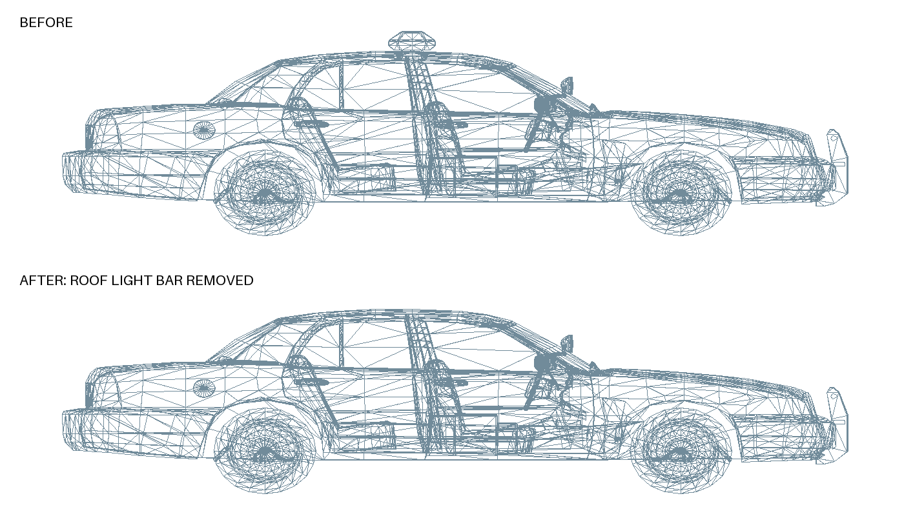

# H1Z1-CopCarLightBar-Zone

**Script by ZzeK**

A Windows one-click patch package for ROTK. Removes the cop car roof light bar and reduces toxic-gas haze while leaving it visible.

## Quick guide

1. Download the project ZIP and extract the entire folder.
2. Close ROTK/H1Z1.
3. Double-click **Apply Patches.cmd**.
4. Select your ROTK installation folder (for example `C:\Games\ROTK`), then click **OK**. The script finds `Resources\Assets` and starts automatically.
5. Wait for **SUCCESS** or **Already in the requested state**, then start the game.

Apply, Restore, and Check ask you to select the game folder each time. Cancel exits without changing files; an invalid folder is rejected before patching.
Keep `Patch.ps1`, `manifest.json`, and the `files` folder together.
Uses built-in Windows PowerShell; no Python or extra downloads needed.

## Restore or check

- **Restore Original.cmd** restores the original cop-car and gas assets.
- **Check patch status.cmd** checks installation without changing game files.
- Keep the automatically created `backups` folder on your computer.

Repeated runs skip installed changes. After a game repair or update, run Apply again. The script stops if it finds an unfamiliar asset version; that version needs an updated package.

## Included changes

- Cop car: removes the roof light bar, brackets/feet, and separate siren-light geometry in the supported model versions.
- Toxic gas: sets density and nearby-haze coefficients to one-eighth of the original values. Actual screen opacity is nonlinear; in-game appearance may vary.

## Before and after



Actual extracted model geometry: original above, patched below. This is an untextured wireframe preview, not an in-game screenshot. A verified in-game gas comparison is not included yet.

## Different install folder

```powershell
powershell.exe -NoProfile -ExecutionPolicy Bypass -File .\Patch.ps1 -Mode Apply -AssetsPath "D:\Games\ROTK\Resources\Assets"
```

## Asset changes and rules

The only game files this script alters are selected `.pack2` asset archives under `Resources/Assets`, including the archive indexes needed to store those changes. It changes cop-car model geometry and toxic-fog rendering assets. It does not edit the game executable, inject into the running game, or change server-side damage or zone logic. It also creates local backups.

Changing assets alone does not establish that a modification is permitted or is not considered cheating. This patch changes visibility, and ROTK-specific approval has not been verified. The original H1Z1 [published policy on modifying game files](https://www.h1z1.com/news/modifying-game-files) prohibited in-game asset modifications; that historical policy does not establish the current ROTK rules. Confirm permission with ROTK staff before use.

By ZzeK
